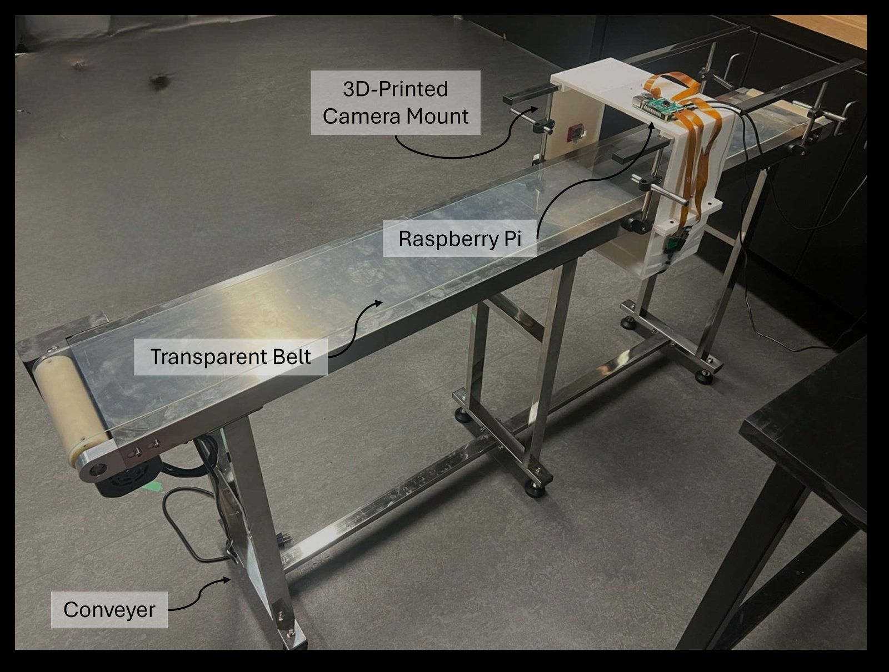
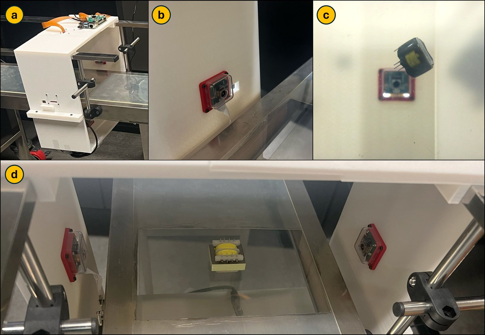
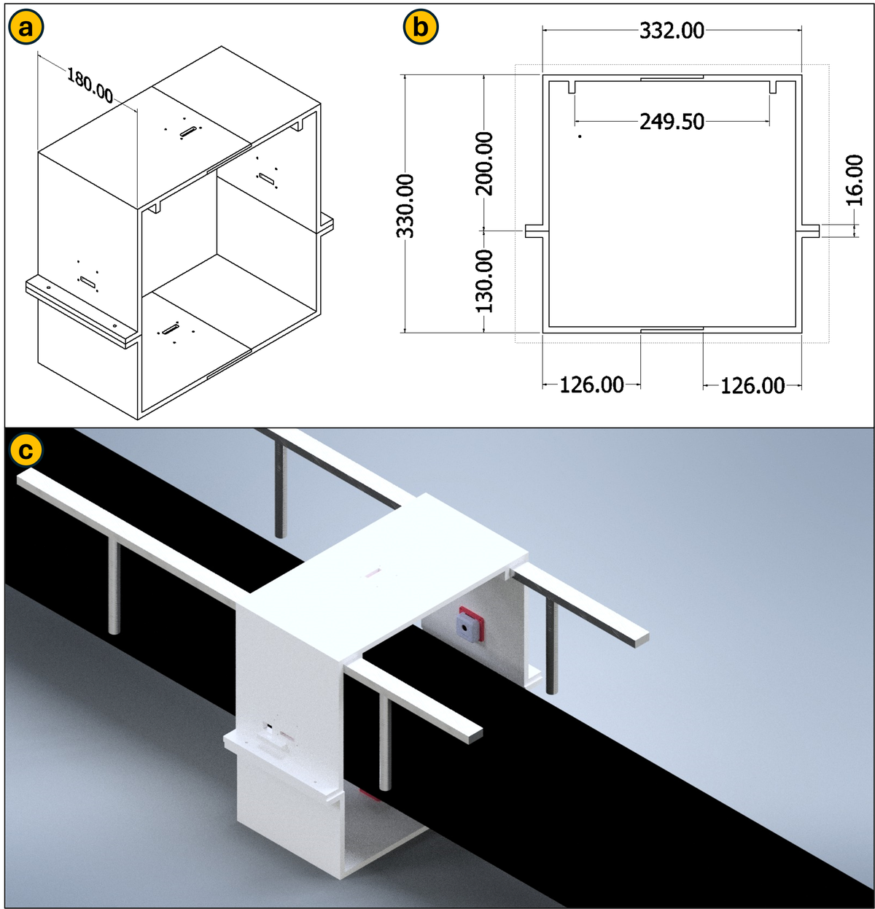
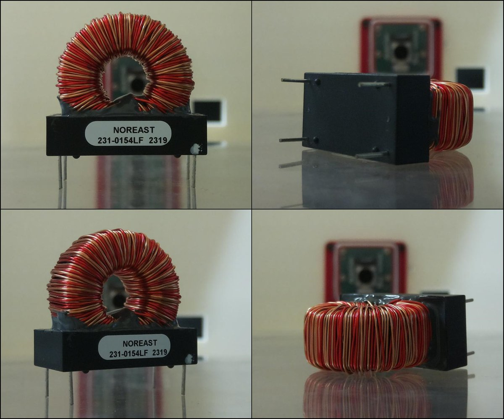
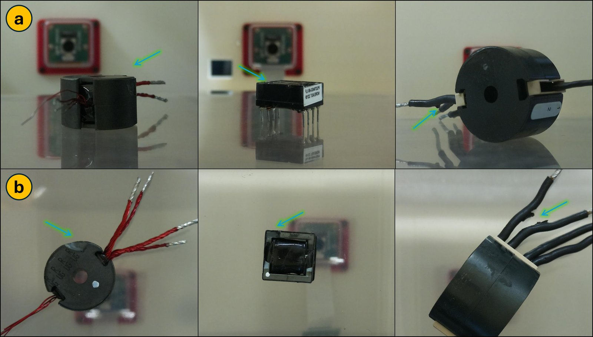
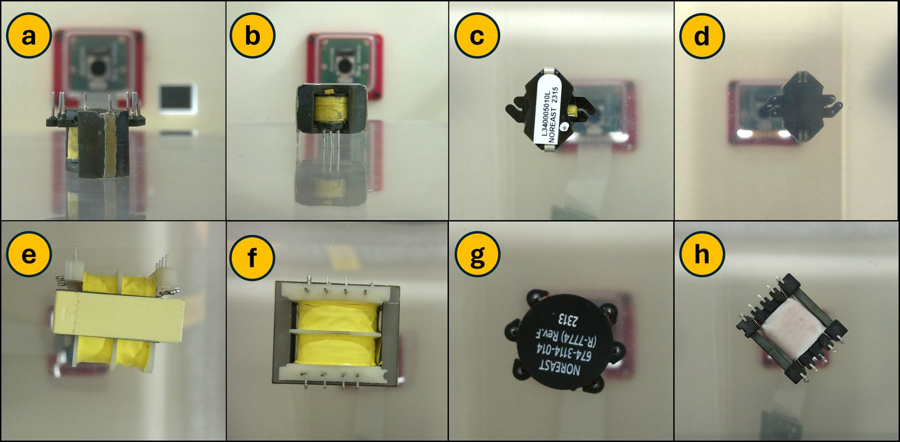

# Automated Visual Inspection of Electrical Transformers

A deep-learning inspection station that images an electrical transformer from four sides and classifies it as **standard**, **defective**, or **needs manual inspection**. Built for my [M.Sc. thesis](https://hdl.handle.net/10012/20604) at the University of Waterloo with Noreast Electronics as the industry partner, and deployed at their facility, where it reached 97% real-time inspection accuracy.



## Highlights

- **90.8% test accuracy** across 16 classes (8 transformers, each standard or defective), up from 69.2% for a binary standard/defective model on the same dataset.
- **Four-camera station** with a transparent conveyor belt, so one camera can image the part from below.
- **Runs on a Raspberry Pi 4 CPU**, taking 1 minute 6 seconds per part from capture to decision.
- **97% real-time accuracy** after deployment, measured against Noreast's inventory of defective parts.

## How it works

A conveyor carries each part into a 3D-printed camera mount. Four cameras view it from the top, bottom, left and right; the bottom camera looks up through a transparent belt and a rectangular cut-out in the conveyor bed. A Raspberry Pi 4 drives all four cameras and runs the classifier.

Each face is classified on its own, because a defect is rarely visible from every side. The model is a ResNet-101, pretrained on ImageNet and fine-tuned on 512×512 images, that predicts the transformer's identity and condition together (`Obj1_good`, `Obj1_bad`, ...).

The four face predictions are combined into one decision for the part, shown on a status LED:

- **Red, defective:** at least one face is classified as defective.
- **Green, standard:** all four faces are classified as standard.
- **Yellow, manual inspection:** the model's confidence is below 75%, a threshold set with the industry partner.


## Hardware

The camera mount was designed in CAD and 3D-printed. Its width was chosen to keep background out of the images. The first version suffered from stray light: reflections and diffraction inside the mount distorted the images. The second iteration changed the contour dimensions and the print infill density, which removed most of the effect.





The printable STL files are in [`hardware/`](hardware/), and GitHub previews them in 3D.

Components:

- Raspberry Pi 4 Model B (8 GB)
- Arducam 16 MP IMX519 autofocus synchronized quad-camera kit (4656×3496 pixels) on a UC-512 camera-array HAT
- Ribbon-to-HDMI adapters to extend the camera cables; ten HDMI cables were tested to find ones that connected reliably
- VEVOR belt conveyor, 1800×200 mm belt, 90 W motor, 0 to 18 m/min, fitted with a transparent belt
- IoT relay
- Green, red and yellow status LEDs on GPIO 22, 17 and 27

## Dataset

The dataset covers eight electrical transformers of about 5×5×5 cm, in cylindrical, cubic and irregular shapes. Each transformer has a standard unit and a defective counterpart; parts without a pair were excluded so the model always learns from matched examples. Defects include scratches, cracks, missing structures and deformities.


Each part was imaged in about 11 orientations on average, with four faces per orientation. That gave about 100 images per standard part and 130 per defective part, roughly 2,000 captured images in total, and about 7,000 after augmentation.



**Labeling per face.** A defective part usually shows its defect on only some faces, so each face is labeled separately rather than the part as a whole. Faces were labeled with a small GUI offering *standard*, *defective* and *uncertain*; uncertain faces were reviewed and either labeled or removed.



**Focus.** Early captures swept each camera through a range of lens positions, and the thresholded-gradient (GRAT) focus measure picked the sharpest frame. Because the parts are similar in size and sit at a fixed distance, the algorithm kept choosing the same lens position for each camera, so the final setup uses a fixed lens position per camera. That removes the focus sweep and speeds up inspection.

**Augmentation.** Centre cropping, noise, blur, sharpening, brightness changes, rotation and flipping were all tried. Centre cropping and noise did not reflect real variation on the line and hurt performance, so general augmentation was narrowed to rotation and flipping. Rotation, flipping and Gaussian noise were used to balance the classes.

## Repository structure

```
├── hardware/                 # printable STL files for the camera mount
├── pi/                       # runs on the Raspberry Pi
│   ├── capture_dataset.sh    # four faces per orientation, optional focus stacks
│   ├── inspect.sh            # capture four faces and classify the part
│   ├── preview_cameras.sh    # live preview of each camera for alignment
│   ├── test_leds.py          # cycles the status LEDs to check wiring
│   └── cameras.sh            # I2C camera switching and capture helpers
├── matlab/
│   ├── run_pipeline.m        # end-to-end data preparation example
│   ├── select_best_focus.m   # sharpest frame per orientation and face
│   ├── split_dataset.m       # stratified 70/20/10 train/val/test split
│   ├── augment_images.m      # flips, Gaussian noise, rotations
│   ├── resize_images.m
│   └── third_party/fmeasure/ # focus measure operators (Said Pertuz, BSD)
├── python/
│   ├── train.py              # fine-tuning with early stopping
│   ├── evaluate.py           # test metrics, including the manual-inspection rate
│   ├── realtime_inspect.py   # four-face decision used on the station
│   ├── augment_images.py     # OpenCV augmentation
│   ├── compare_architectures.sh  # trains and evaluates ResNet-18 to 152
│   └── model_utils.py        # model building, checkpoint loading, prediction
└── docs/
    ├── retraining-guide.md   # capturing images and adding new parts
    └── images/
```

## Getting started

### Capturing images (Raspberry Pi)

```bash
pi/preview_cameras.sh          # check alignment on all four cameras
python3 pi/test_leds.py        # check the status LEDs
pi/capture_dataset.sh 5 bad    # part 5, defective, orientation by orientation
```

Images are saved to `Obj<N>_<condition>/` as `Obj<N>_<condition>_Or<orientation>_f<face>.jpg`. Set `FOCUS_STACK="7 8 9 10 11 12"` to capture a focus stack per face instead.

### Data preparation (MATLAB, Image Processing Toolbox)

Copy the capture folders into `raw/`, then:

```matlab
addpath(genpath('matlab'))
select_best_focus('raw', 'best_focus', {'Obj1_good', 'Obj1_bad'})
% Review: move faces in Obj1_bad that show no visible defect into Obj1_good
split_dataset('best_focus', 'data')
augment_images('data/train/Obj1_bad')
```

`matlab/run_pipeline.m` runs these steps for all objects.

### Training and evaluation (Python)

```bash
pip install -r requirements.txt

python python/train.py --data data --arch resnet101 --image-size 512 --output checkpoints/model.pth
python python/evaluate.py --data data/test --checkpoint checkpoints/model.pth --threshold 0.75
```

### Inspecting a part (Raspberry Pi)

```bash
pi/inspect.sh checkpoints/model.pth --leds
```

The number of classes is read from the dataset folders, and the class names are stored in the checkpoint. Adding a new part therefore needs no code changes, only its two folders and a retraining run. See [docs/retraining-guide.md](docs/retraining-guide.md).

## Training setup

| Setting | Value |
|---|---|
| Model | ResNet-101, ImageNet-pretrained, fully fine-tuned |
| Input size | 512×512 |
| Batch size | 4, matching the four faces captured per part |
| Optimizer | SGD, learning rate 0.0001, momentum 0.9 |
| Epochs | up to 500, with early stopping |
| Split | 70% train, 20% validation, 10% test |
| Software | Python 3.10.12, PyTorch 2.0.1, CUDA 12 |
| Training hardware | Intel Core i9-13900HX, NVIDIA RTX 4070 (8 GB), 32 GB RAM |
| Inference hardware | Raspberry Pi 4 CPU |

## Design notes

**Multi-class instead of standard/defective.** The first models were binary. Pairing each part's identity with its condition gives 16 classes and raised test accuracy from 69.2% to 90.8% on the same images and split.

**Balanced classes.** Defective parts were imaged more than standard ones. Augmenting to balance the classes raised accuracy from 72% to 80%; the unbalanced model also had a much higher false-positive rate.

**Split before augmenting.** In this repository each class is split into train, validation and test first, and only the training split is augmented. This keeps flipped or rotated copies of a test image out of training.

**Confidence fallback.** Rather than forcing a decision on every part, predictions below 75% confidence are routed to a person. `evaluate.py` reports accuracy on the automatic decisions and the share of parts sent to manual inspection, which is the trade-off the threshold controls.

**Same conditions in training and inspection.** Training images are centre-cropped to 2000×2000 from the full camera frame before resizing, and `realtime_inspect.py` applies the same crop to raw captures. The station captures with the same per-camera lens positions used for training, so the model sees parts at the same scale and sharpness in production.

## Results

Initial binary experiments on six objects, comparing ResNet depths:

| Model | Accuracy | Epochs | Training loss |
|---|---|---|---|
| ResNet-18 | 48% | 11 | 0.19 |
| ResNet-34 | 68% | 11 | 0.13 |
| ResNet-50 | 76% | 21 | 0.04 |
| ResNet-101 | 80% | 21 | 0.03 |

Main experiments with ResNet-101:

| Dataset | Images | Test accuracy |
|---|---|---|
| Unbalanced | ~2,200 | 72.0% |
| Balanced | ~3,000 | 80.0% |
| Binary, full dataset | ~7,000 | 69.2% |
| 16-class, full dataset | ~7,000 | **90.8%** |

**On the station.** Reliability and repeatability tests had multiple users place parts at random orientations and positions, under different lighting and in different locations; the model identified each part's type and condition correctly throughout. After deployment at Noreast, the system reached 97% real-time accuracy on their inventory of defective parts. Capturing all four images and reaching a decision takes 1 minute 6 seconds per part, which the partner considered reasonable against their existing inspection rate.

**Unseen parts.** Shown an unfamiliar part it was never trained on, the model matched each face to the most similar known part rather than guessing at random. The matches suggest colour is the strongest cue, printed text a weaker one, and size the weakest.



**Zero-shot learning.** The thesis also tested matching ResNet image features to BERT text embeddings. An ImageNet ResNet-101 reached 24%. Using this project's ResNet-101 instead reached 72% on its six training categories and 76% on 16 categories, ten of them never seen in training, without retraining. That work is not part of this repository.

Full details are in the thesis: P. Salib, [*End-to-End Deep Learning-Driven Automation for Enhanced Inspection in Industry*](https://hdl.handle.net/10012/20604), M.Sc. thesis, University of Waterloo, 2024.

## Future work

- A feeder and a servo-driven rack-and-pinion stop to position each part under the cameras, followed by automatic sorting of standard and defective parts
- A six-camera array to cover all faces of the bounding cube
- Autofocus per part, to handle a wider range of sizes
- Labeling and classifying the part as a whole rather than face by face
- Vision-language models such as VisualBERT or ViLBERT to improve zero-shot recognition of new parts

## Limitations

- The model covers a fixed set of 8 transformers of about 5 cm. New parts or new defect types require collecting images and retraining.
- The full dataset and trained weights are not included.
- The labeling GUI and the zero-shot experiments are not part of this repository.

## Project timeline

- **August to December 2023:** data pipeline and first models: augmentation, best-focus selection, the train/validation/test split and the ResNet-18 baseline.
- **By May 2024:** multi-class ResNet-101 model and the Raspberry Pi station scripts; thesis published on 27 May 2024.
- **After the thesis:** deployed at Noreast Electronics.
- **October 2026:** code cleaned up, documented and published here.

The original scripts are preserved in this repository's history, dated from their file save times, under the [`v2024-thesis`](../../tree/v2024-thesis) tag. The only change to them is that a computer user name in two file paths was redacted.

## Acknowledgments

- Noreast Electronics, industry partner for this work
- University of Waterloo, and Prof. William Melek for supervising the thesis
- Focus measure operators by Said Pertuz, used under the BSD license in [`matlab/third_party/fmeasure`](matlab/third_party/fmeasure/LICENSE). See S. Pertuz et al., *Analysis of focus measure operators for shape-from-focus*, Pattern Recognition 46(5), 2013.

## Author

**Philopatear Salib**, [github.com/PhilopatearSalib](https://github.com/PhilopatearSalib)

## License

Copyright © 2024 Philopatear Salib. All rights reserved, except for the code in `matlab/third_party/`, which keeps its original BSD license.
