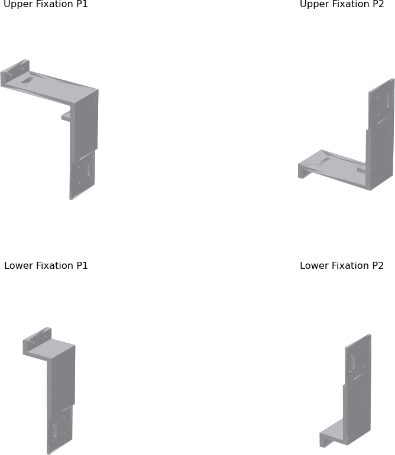

# Camera mount

3D-printable parts for the camera mount. The mount prints as four pieces, two upper and two lower sections, which assemble around the conveyor and hold one camera on each inner face (top, bottom, left and right).

GitHub shows a 3D preview when you open any `.stl` file in [`cad/`](cad/).

| File | Bounding box (mm) |
|---|---|
| [`Upper_Fixation_P1.stl`](cad/Upper_Fixation_P1.stl) | 130 × 60 × 228 |
| [`Upper_Fixation_P2.stl`](cad/Upper_Fixation_P2.stl) | 130 × 60 × 228 |
| [`Lower_Fixation_P1.stl`](cad/Lower_Fixation_P1.stl) | 50 × 60 × 228 |
| [`Lower_Fixation_P2.stl`](cad/Lower_Fixation_P2.stl) | 50 × 60 × 228 |

## Print settings

| Setting | Value |
|---|---|
| Material | PLA |
| Infill | 20% |

## Design notes

The first version of the mount let stray light reflect and diffract inside the structure, which distorted the images. The second version, provided here, changed the contour dimensions and the print infill density to reduce those effects. The mount's width was chosen to keep background out of the camera views.

Overall dimensions of the assembled mount are shown in the [design drawing](../docs/images/mount-cad.png).
